<div align="center">



<br />

<a href="https://git.io/typing-svg"></a>

<a href="https://huseynswe.vercel.app"></a>
<a href="https://github.com/HuseynBlv?tab=repositories"></a>


</div>

## `// profile`

```yaml
name: Huseyn Balayev
location: Baku, Azerbaijan
focus: Java backend engineering & scalable architecture
education: Computer Science @ UFAZ
currently_building: products with real users and real constraints
currently_learning: distributed systems, system design, algorithms
operating_principle: "Small, useful work over vague claims."
```

I care about the less-visible parts of software: clear domain boundaries, predictable APIs, useful observability, and systems that remain understandable as they grow. I also enjoy taking a product from a rough idea to something people can actually use.

## `// deployed work`

<table>
<tr>
<td width="50%" valign="top">

### [`SCAN`](https://github.com/HuseynBlv/SCAN)

Retail receipt exports become deterministic basket intelligence and commercial analytics dashboards.

`Java` `Spring Boot` `React` `Analytics`

</td>
<td width="50%" valign="top">

### [`RideFlow`](https://github.com/HuseynBlv/RideFlow)

A ride-hailing backend built to explore service boundaries, API design, and scalable architecture.

`Java` `Backend` `System Design`

</td>
</tr>
<tr>
<td width="50%" valign="top">

### [`Personal Finance API`](https://github.com/HuseynBlv/personal-finance-api)

Secure account and transaction tracking with spending insights, JWT authentication, and a containerized database.

`Spring Boot` `PostgreSQL` `Docker` `JWT`

</td>
<td width="50%" valign="top">

### [`IsMyJobSafe`](https://github.com/HuseynBlv/IsMyJobSafe)

An AI career-risk and salary-growth SaaS with structured assessments, billing, and webhook-based access control.

`Next.js` `MongoDB` `Groq` `Lemon Squeezy`

</td>
</tr>
</table>

<div align="right">

[view all repositories →](https://github.com/HuseynBlv?tab=repositories)

</div>

## `// infrastructure stack`

<div align="center">


</div>

## `// architecture mindset`

```text
request → contract → domain → persistence → response
             │          │          │
             └──── logs · metrics · traces ────┘
```

- **Clear boundaries:** each component has one job, an explicit contract, and predictable failure modes.
- **Observable by default:** logs, metrics, and traces should explain what the system is doing—not add more mystery.
- **Product minded:** architecture is valuable when it makes the software more reliable and the user experience simpler.
- **Built to evolve:** start with the smallest useful system, then scale from evidence rather than imagination.

## `// activity signal`

<div align="center">


</div>

## `// establish connection`

I’m open to conversations about backend engineering, system architecture, useful software, and technical collaboration.

<div align="center">

### [`portfolio`](https://huseynswe.vercel.app) · [`repositories`](https://github.com/HuseynBlv?tab=repositories)

<sub>Neon infrastructure. Clear signal. No unnecessary noise.</sub>

</div>
